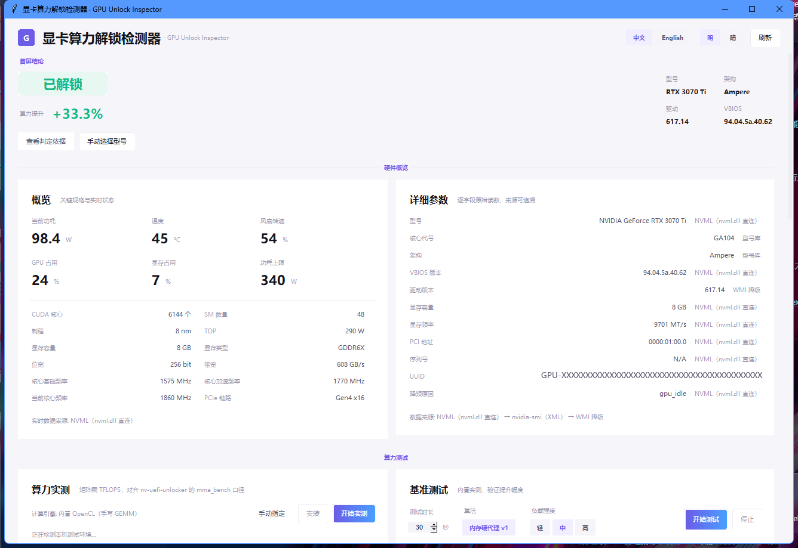
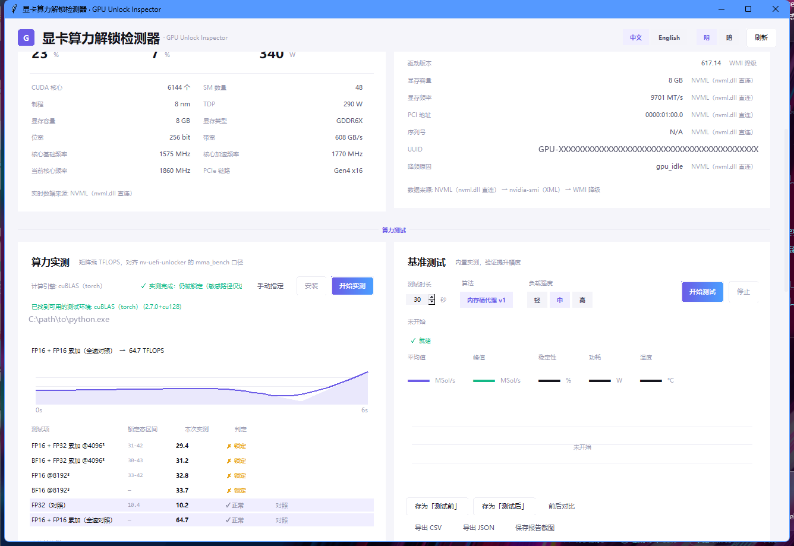
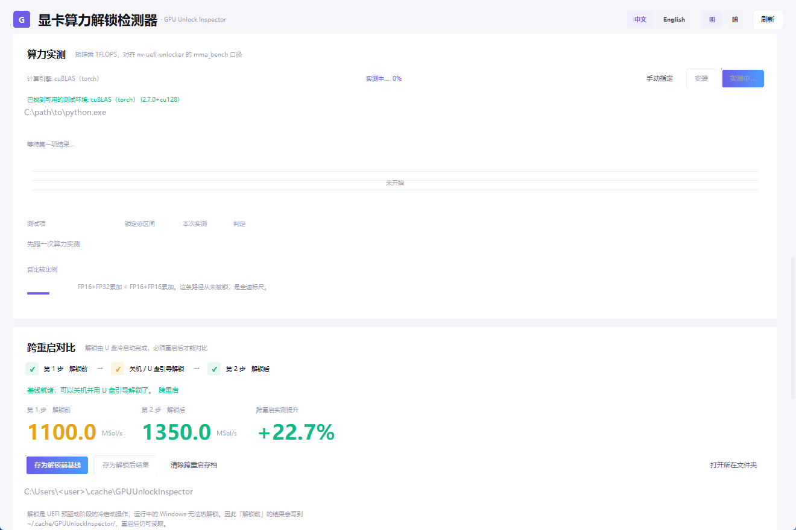
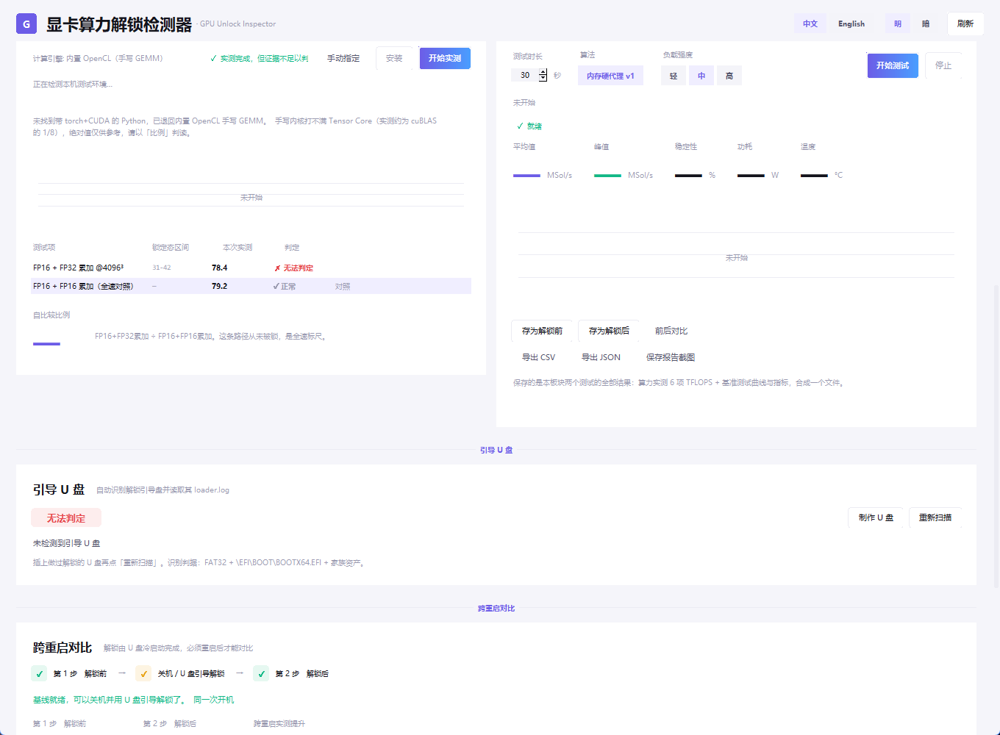
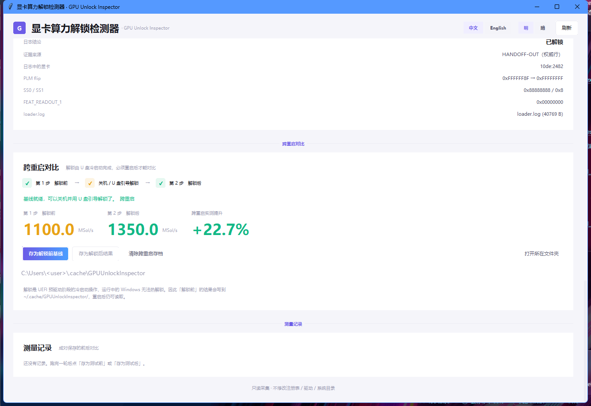
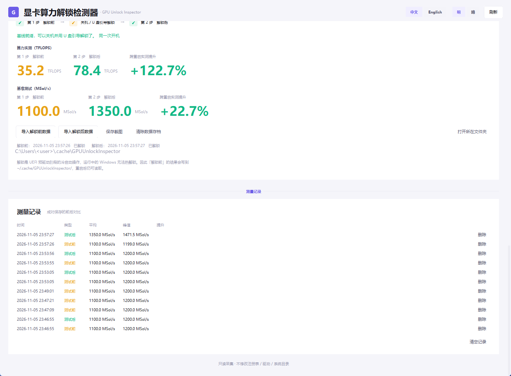
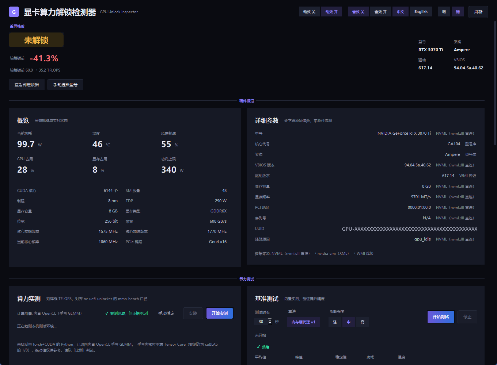
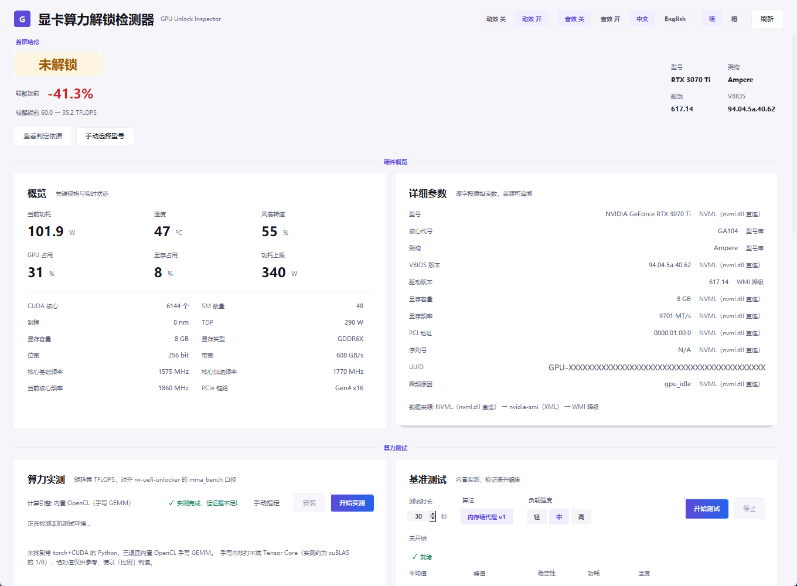

<div align="center">

# GPUUnlockInspector

**Measure the tensor throughput at startup — don't guess.**
Reads full NVIDIA GPU details → runs a live TFLOPS benchmark → compares against the model's
unlocked reference → prints a verdict.

Single-file portable Windows tool · no install · no admin rights · read-only collection

[](../../releases/latest)
[](../../releases/latest)
[](https://www.python.org/)
[](LICENSE)

**English** · [简体中文](README.md)

</div>

---



## Table of contents

- [Why this exists](#why-this-exists)
- [Quick start](#quick-start)
- [How the verdict is made](#how-the-verdict-is-made)
- [Interface tour](#interface-tour)
- [Logs](#logs)
- [Compute engines](#compute-engines)
- [Bootable USB](#bootable-usb)
- [Cross-reboot comparison](#cross-reboot-comparison)
- [Design system](#design-system)
- [Build](#build)
- [Self-test](#self-test)
- [Known limitations](#known-limitations)
- [License & credits](#license--credits)

---

## Why this exists

Two camps argue about GPU unlock state:

- one says "if the driver version is new enough, it's unlocked";
- the other says "only the loader register dump at boot proves it".

Both are right, and both are insufficient. **A driver version only says the vendor lifted a limit —
not that this card is running at full speed right now. And `loader.log` only says the previous
boot succeeded — not that the value survived.** The registers live in the always-on island: they
survive FLR, die on power loss, and the driver may re-derive the locked value before GC6 wake or bind.

The stance of this tool is simple:

> **Don't infer — measure.** Run the tensor benchmark at startup and compare against what this
> model should reach when unlocked. Far below means locked; close means unlocked.

---

## Quick start

### Prebuilt binary (recommended)

1. Grab `GPUUnlockInspector-v1.0.0-win64.zip` from [Releases](../../releases/latest)
2. Extract anywhere (**avoid `C:\Program Files`** — config and logs live next to the exe)
3. Double-click `GPUUnlockInspector.exe`

The first screen gives the verdict immediately: **unlock state + how far you are from it.**
On first launch it probes for a benchmark environment (torch + CUDA) and offers to install it
(~2–3 GB, into the exe folder, never system-wide).

No Python required, no admin rights required.

### From source

```bat
git clone https://github.com/AsterLuo/gpu-unlock-inspector.git
cd gpu-unlock-inspector
python src\main.py
```

Requires the official Python 3.10+ build (with tkinter). **Zero third-party dependencies** —
NVML, OpenCL and Win32 are all reached through `ctypes`.

---

## How the verdict is made

```
startup
  → probe benchmark environment (torch+CUDA present → continue; otherwise offer install / portable Python)
  → run the tensor benchmark (FP16/BF16 × FP32/FP16 accumulate, 6 cases)
  → look up the "unlocked reference" for this GPU model
  → measured < reference × 0.75  →  LOCKED
    measured ≥ reference × 0.75  →  UNLOCKED
    model/reference or measurement missing →  UNKNOWN
```

### Two criteria — reference first

| Criterion | Condition | Source |
| --- | --- | --- |
| `vs_reference` (primary) | model DB has an unlocked reference for this card | `gpu_db.json` → `tflops_reference.by_model[id]` |
| `self_ratio` (fallback) | no reference available; uses FP16+FP32acc ÷ FP16+FP16acc | the full-speed path was never locked |

`self_ratio` thresholds: `< 0.65` locked, `> 0.85` unlocked, in between unknown.

### Two different kinds of "unlock" — don't conflate them

| Dimension | What it unlocks | How this tool decides |
| --- | --- | --- |
| **LHR hashrate limiter** | Mining hashrate | NVIDIA removed it in R515 (Windows 516.94); driver ≥ 516.94 counts as lifted |
| **Tensor / PLM override** | FP16/BF16 tensor throughput | The USB reaches UEFI pre-driver stage and overrides registers; this tool **measures** and compares |

### Where the reference values come from

The formula is from [nv-uefi-unlocker](https://github.com/physicsdolphin/nv-uefi-unlocker)
`docs/theoretical-uplift.md §6`:

```
FP16acc tensor peak (TFLOPS) = SM count × 256 × 2 × boostGHz ÷ 1000
```

It has been validated at three points by that project: 3090 (71.5 vs 71 datasheet),
4090 (165 vs 165), 2757 (178 vs 177.4 measured).

| Model | Theoretical peak | Locked | Unlocked |
| --- | ---: | --- | --- |
| RTX 3060 12G | 25.5 | 10–14 | 24–26 |
| RTX 3070 | 40.6 | 15–23 | 38–42 |
| **RTX 3070 Ti** | 43.5 | **31–42** | **77–84** |
| RTX 3080 10G | 59.5 | 22–34 | 56–62 |
| RTX 3090 | 71.2 | 27–41 | 67–74 |
| RTX 4070 Ti | 80.2 | 30–46 | 75–83 |
| RTX 4090 | 165.2 | 62–95 | 155–172 |

> **Only the RTX 3070 Ti row is a real measurement on this machine.** The rest are derived from
> the formula. For better accuracy, run once in the unlocked state on your card and write the
> measured value into that model's `unlocked` field in `gpu_db.json`.

### Log freshness check (second most important)

`loader.log` on the USB records **the previous boot**, not the current state:

- only a log with `mtime >= this boot's start - 120s` counts as "this boot"
- stale logs get `notes: ["log_stale"]` and are **excluded from the verdict**
- **the benchmark always outranks the log** (`relocked` = log says unlocked, measurement says locked)

> Real case: the log was written by yesterday's 09:04 boot; today the card measures locked.
> The register values live in the always-on island — they survive FLR, die on power loss,
> and can be re-derived to locked before the driver's GC6 wake or bind.

---

## Interface tour

### 1. Hero verdict + hardware overview


| Block | Contents |
| --- | --- |
| **Hero verdict** | State badge (unlocked / unlocking / locked / unknown) + compute uplift % + model / architecture / driver / VBIOS |
| **Overview** | Power, temperature, fan RPM, GPU utilization, memory utilization, power limit, CUDA cores, SM count, process node, TDP, memory type, bus width, bandwidth, core clocks, PCIe link |
| **Detailed parameters** | Raw per-field readings, each tagged with its source (NVML direct / nvidia-smi / WMI fallback / model DB) |

**Three-state hero**: before any measurement the badge reads "pending" (neutral gray) —
driver-version inference is shown only in the "why this verdict" table and never pretends to be
a measurement. The number below the badge: no measurement → "current compute —";
measurement but no pre-unlock archive → "current compute xx TFLOPS"; both present →
"vs. pre-unlock ±x.x%" (**signs are honest**, negatives in red).

### 2. Tensor benchmark + baseline benchmark (side by side)



**Tensor benchmark** (left): six TFLOPS cases, each with locked range, measured value and verdict.

| Case | Purpose |
| --- | --- |
| FP16 + FP32 accumulate @4096³ | **primary criterion**, closest to mma_bench semantics |
| BF16 + FP32 accumulate @4096³ | same, BF16 path |
| FP16 @8192³ | larger shape, memory-bandwidth pressure |
| BF16 @8192³ | same |
| FP32 (control) | unaffected by the Tensor path — sanity check |
| FP16 + FP16 accumulate (full-speed control) | **full-speed yardstick**, this path was never locked |

**Baseline benchmark** (right): in-memory proxy_v1 stress test reporting average / peak /
stability / power / temperature. Used only for before/after comparison, never for the verdict.

**Feedback rule: show a percentage only when real progress exists; otherwise show a spinner —
never fake progress.**

| Operation | Feedback |
| --- | --- |
| Fetch boot assets (download maker + generate) | stage text + real byte progress (falls back to an indeterminate bar) + cancel |
| Write USB (format + copy) | stage text + per-file percentage |
| Tensor benchmark | per-case progress + live TFLOPS + curve |
| Download portable Python / install torch | real percentage (Content-Length / pip progress parsing) |
| Scan USB / refresh GPU info / build USB | spinner (not estimable) |



### 3. Bootable USB



Detects unlock boot sticks and reads their `loader.log`:

- **Detection**: FAT32 + `\EFI\BOOT\BOOTX64.EFI` + family assets
- **Evidence fields**: log verdict, HANDOFF-OUT line, SS0/SS1 selectors, FEAT_READOUT_1, log size
- **Family routing**: PCI Device ID picks which family the stick must be built for

| Family | Device ID range |
| --- | --- |
| `tu10x` | `0x1e02–0x1fff`, `0x2182–0x21d1` |
| `ga102` | `0x2200–0x22ff`, `0x2400–0x25ff` |
| `ad102` | `0x2600–0x28ff` |

RTX 50 series, GA100, Pascal and older are rejected outright (the reference project has not
adapted them).

**Building requires two confirmations**: first a listing of the drive to be formatted and its
capacity, then typing the drive letter. Assets are not bundled — they are fetched on demand
(~81 MB, maker plus firmware) and the original license applies to them.

### 4. Cross-reboot comparison



Unlocking happens at the UEFI pre-driver stage via a USB boot — **there is no hot unlock inside
running Windows** — so the before/after comparison must span a reboot:

| Step | What you do |
| --- | --- |
| ① First boot (locked) | run both tests → click **save as pre-unlock** in the compute card |
| ② Shut down, unlock via USB boot | follow the reference project's procedure |
| ③ Second boot (unlocked) | run again → click **save as post-unlock** |
| ④ Auto-pair | gets a **compute** and a **baseline** comparison, side by side, each with its own uplift % |



One click stores **both tests of the whole section** (6 TFLOPS cases + baseline curve and
metrics) as a single JSON, split into two subfolders:

```
~/.cache/GPUUnlockInspector/
├─ before/          pre-unlock archives (one JSON per run)
├─ after/           post-unlock archives
├─ sessions.json    (legacy single-file archive, kept for compatibility)
└─ state.json
```

Folders are created level by level. Reboots, power-offs and USB boots don't lose them;
deleting the folder clears everything.

**Button layout** (the "save as" entry exists in exactly one place, so one action never has two buttons):

| Location | Button | Effect |
| --- | --- | --- |
| Compute card | Save as pre-unlock | writes the current two tests into `before/` |
| Compute card | Save as post-unlock | writes into `after/`, also used as an on-machine reference |
| Cross-boot card | Import pre / Import post | pick a JSON from elsewhere (another machine, a backup drive) |
| Cross-boot card | Clear archives | empties the JSONs in `before/` and `after/` (folders kept) |
| Cross-boot card | Save screenshot | copies the whole card to the **clipboard** — just Ctrl+V it to anyone |

Screenshots use pure Win32 (BitBlt + `CF_DIB`) with no Pillow dependency, and also leave a PNG
backup next to the exe.

### 5. Dark and light themes

| Dark | Light |
| --- | --- |
|  |  |

The top bar toggles **中文 / English**, **dark / light**, **motion on/off** and **sound on/off**.

### 6. Onboarding and progress dialogs

| Missing environment | Install progress | Generic progress |
| --- | --- | --- |
|  |  |  |

---

## Logs

`gpu_inspector.log` sits next to the exe and rotates to `.1` past 2 MB.

```
22:32:42.952 [INFO ] [envscan]      done: 1 candidates
22:32:43.708 [INFO ] [verify]       auto_verify: start with ...\python.exe
22:32:49.283 [INFO ] [tflops]       verdict=locked source=vs_reference worst_ratio=0.375
22:32:49.362 [INFO ] [verdict]      final=locked (from compute)
```

Set `GPUINV_LOG=DEBUG` for verbose output. Check this file first when something misbehaves.

---

## Compute engines

A single-file exe cannot carry torch (~2 GB), so there are two paths:

| Engine | When | Trustworthiness |
| --- | --- | --- |
| **cuBLAS** (calls a local Python that has torch) | torch + CUDA detected | same order of magnitude as the reference project |
| **Built-in OpenCL** (hand-written GEMM) | no torch available | absolute values are ~1/8; **read ratios only** |

The UI always labels which engine produced the numbers (two places on the hero and the header of
the compute card). Without torch, "start" first asks whether to install it: it goes into
`<exe dir>\tools\torch-venv` and never touches the system; if no system Python is found, a
~21 MB portable build is downloaded.

---

## Design system

The UI is organised around **design tokens**, all in `src/core/theme.py` — change that one file to
reskin.

### Colors and contrast

Both light and dark token sets were measured so that every foreground/background pair is
**≥ 4.5:1** (WCAG AA body text), continuously enforced by
`tests/test_selfcheck.py::test_a11y_and_tokens`.

| Token | Light | Ratio | Dark | Ratio |
| --- | --- | ---: | --- | ---: |
| `ink` body | #14141c | 18.3 | #e8eaf4 | 14.6 |
| `ink_soft` secondary | #55556b | 7.3 | #b6bacd | 9.1 |
| `ink_faint` muted | #64647a | 5.8 | #82879e | 4.9 |
| `violet` accent | #5b4bd6 | 6.1 | #8b7cff | 5.4 |
| `ok` success | #107a58 | 5.3 | #2ee6a8 | 10.8 |
| `warn` warning | #9c5a00 | 5.4 | #f5b545 | 9.7 |
| `bad` error | #c62828 | 5.6 | #ff6b6f | 6.3 |

### Motion tokens

| Name | Duration | Use |
| --- | --- | --- |
| `instant` | 80ms | press feedback |
| `fast` | 140ms | hover / focus / theme switch |
| `base` | 200ms | fade-in, number roll |
| `slow` | 320ms | card entrance |
| `spin` | 900ms | one spinner revolution |

Easing uses standard cubic-bezier curves: `standard(0.2,0,0,1)` in, `decelerate(0,0,0.2,1)`
settle, `overshoot(0.34,1.56,0.64,1)` slight bounce. Tk has no native bezier, so
`theme.cubic_bezier()` solves x with 16 bisections and reads y — error below 1e-5.

### Degradation

- Windows "reduce motion" enabled → every transition is disabled automatically
- The top bar also has **motion** and **sound** switches; sound is off by default
- When disabled, `anim.run()` just calls back once with the final value — no logic changes

### Sound

Three very short cues, pure Win32 `PlaySound` on in-memory WAV (no audio library, no resource files):

| Cue | Duration | Gain | When |
| --- | --- | --- | --- |
| click | 40ms | 0.18 | any button activation |
| success | 120ms | 0.22 | success (C5→E5 rising) |
| error | 160ms | 0.20 | failure (A4→F4 falling) |

### Responsiveness and accessibility

| Breakpoint | Width | Layout |
| --- | --- | --- |
| `md` and up | ≥ 1080px | two columns (overview/details, compute/baseline) |
| below `md` | 880–1079px | single stacked column |

- every button is `takefocus=1`, reachable with `Tab`, and `Space`/`Enter` activate it
- focus draws a 2px `focus_ring`; all four states (normal/hover/active/disabled) are distinguishable
- disabled sets `cursor=arrow` + `disabled_fg` and stops responding

---

## Build

```bat
build.bat
```

Requires Python 3.10+ (official build with tkinter). Output: `dist/GPUUnlockInspector.exe` (~18 MB).

Flow: locate Python → install PyInstaller/Pillow into `_build_deps` (never system-wide) →
PyInstaller build → collect the payload. Single-file cold-start cost is mostly extraction,
measured at ~1.9s.

---

## Self-test

```bat
python tests\test_selfcheck.py
```

**306 checks, all green, no GPU needed.** Coverage:

- i18n key-set integrity (Chinese and English keys must match one-to-one)
- model DB loading / matching / graceful degradation on corruption
- the four verdict states (unlocked / locked / unknown / relocked)
- log freshness (`log_is_current_boot`)
- HWiNFO shared-memory parsing (unit-tested on a synthetic buffer)
- cross-reboot archives, `before/`+`after/` layout
- clipboard DIB encoding (24-bit bottom-up, 4-byte row alignment)
- portable Python bootstrap, feedback widget state machine, self-execution guard
- **core + ui use stdlib only** (dependency guard)

---

## Known limitations

1. **Most reference values are estimates** (only RTX 3070 Ti is a real on-machine measurement).
2. **cuBLAS and mma_bench use different conventions**; thresholds are taken per convention.
3. **The built-in OpenCL kernel cannot saturate Tensor Cores** (~1/8 of cuBLAS), so absolute
   values are not directly comparable to the reference project.
4. **Unlisted models** yield "unknown"; you can pick a model manually to see reference data
   (confidence capped at "medium").
5. **USB building formats the target drive** and needs two confirmations.
6. **HWiNFO is an optional enhancement**; without it the refresh rate is NVML-limited (~1 Hz power).
7. **Only the first GPU is judged.**
8. Installing portable Python / torch requires network access.

---

## License & credits

- This source is released under the [MIT](LICENSE) license.
- The LHR removal version comes from NVIDIA's official release notes.
- Ethash reference figures come from [LHRv2Unlocker](https://github.com/LiyuanLucasLiu/NvidiaRTX-LHRv2Unlocker).
- The verdict formula, family routing and `ssdiag` come from
  [physicsdolphin/nv-uefi-unlocker](https://github.com/physicsdolphin/nv-uefi-unlocker) (GPL-2.0).
  **This project contains none of its code** — it only invokes that project's independently
  published executables and public documentation data. Those assets are not redistributed here;
  the user downloads them at runtime under their original license.
- The visual baseline comes from the "soft light" token system (`01-tokens.css`).

---

<div align="center">

**Read-only collection · no registry changes · no driver installs · no system writes · no background service**
Config and logs live next to the exe — delete the folder to uninstall completely.

</div>
