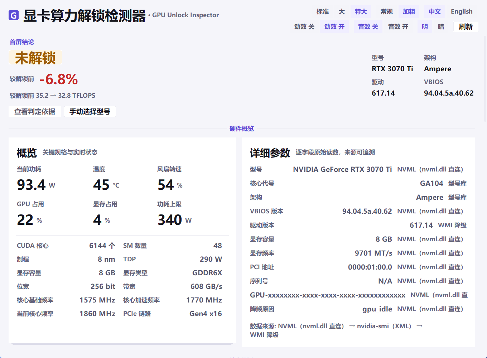
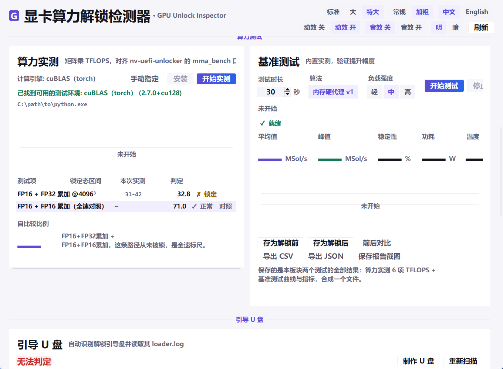
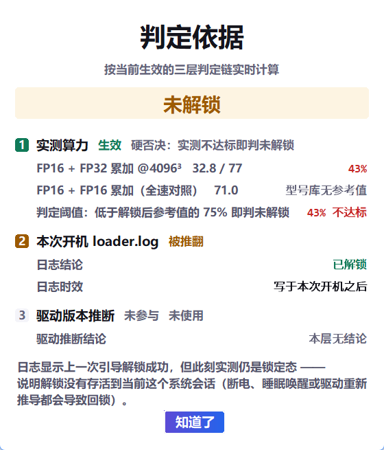
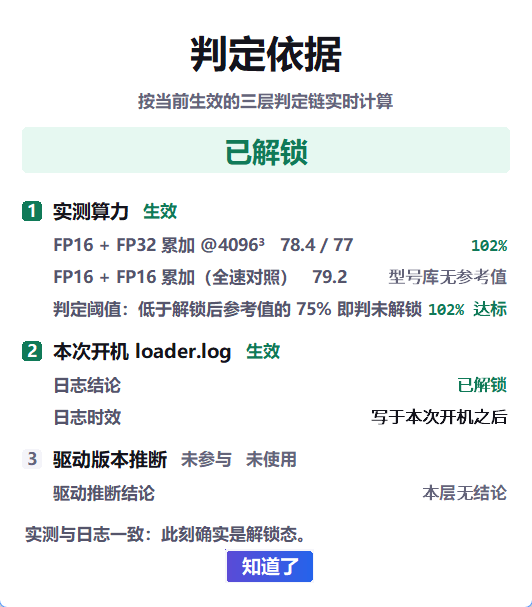
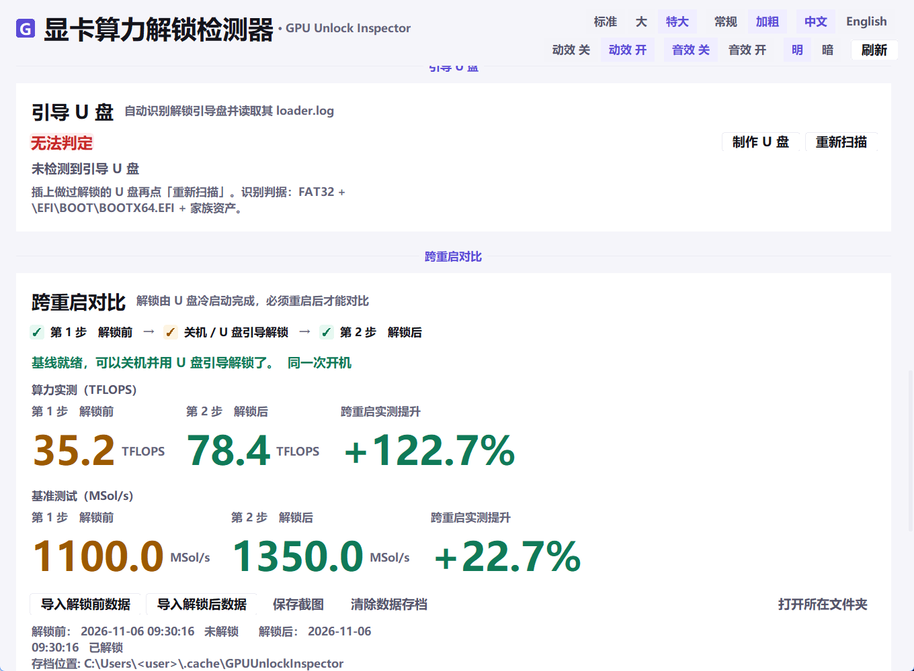
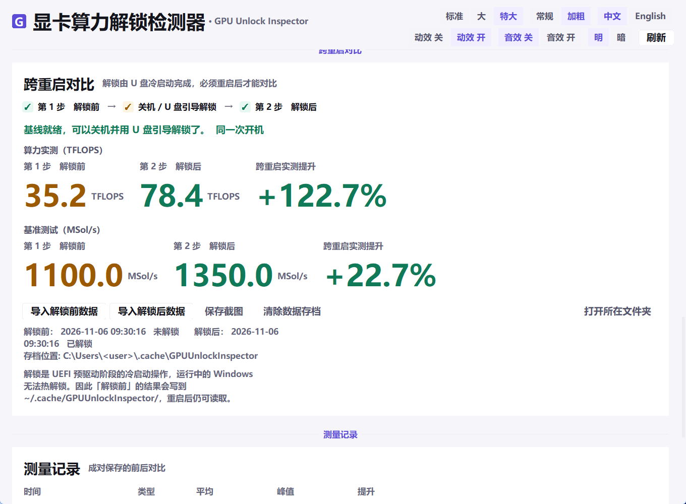
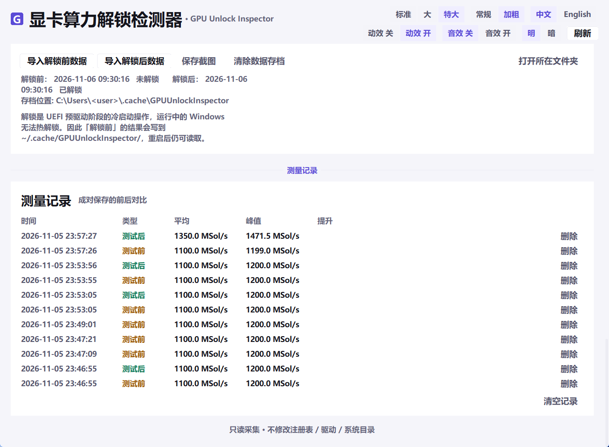
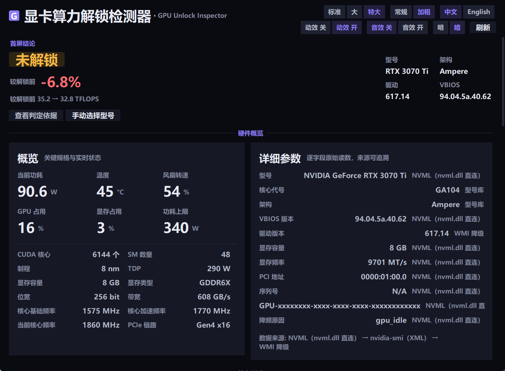
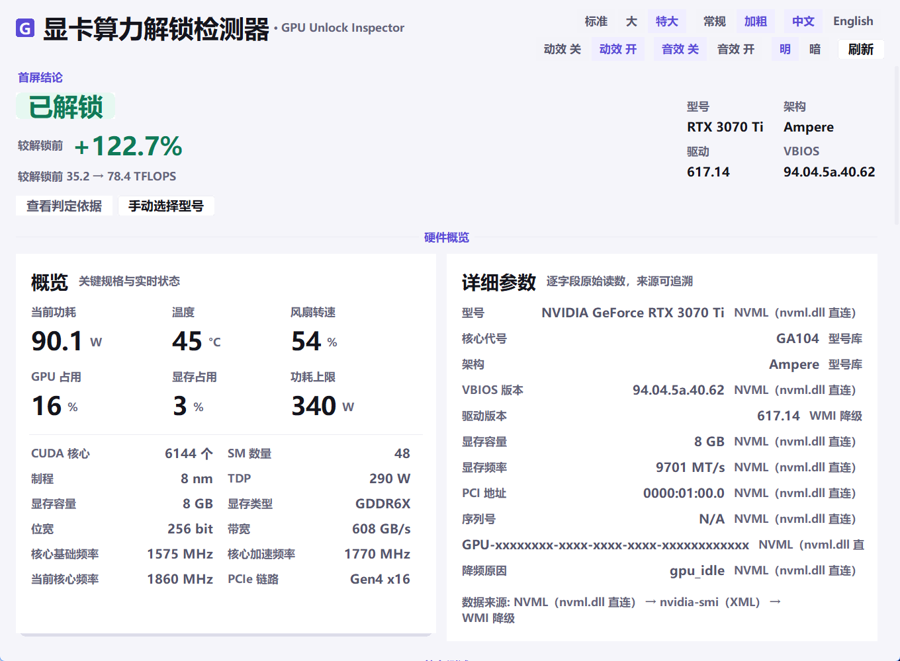
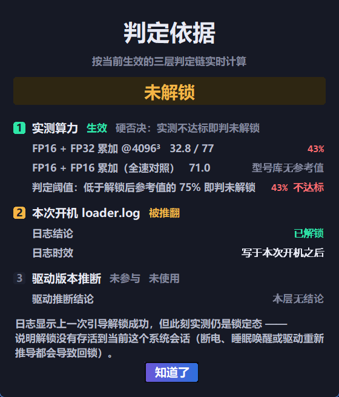

<div align="center">

# GPUUnlockInspector · 显卡算力解锁检测器

**启动就实测 TFLOPS，别猜。**
读取 NVIDIA 显卡完整参数 → 现场跑张量算力 → 与「该型号解锁后参考值」比对 → 给出结论。

单文件便携 Windows 工具 · 免安装 · 免管理员权限 · 只读采集

[](https://github.com/AsterLuo/gpu-unlock-inspector/releases/latest)
[](https://github.com/AsterLuo/gpu-unlock-inspector/releases/latest)
[](https://www.python.org/)
[](https://github.com/AsterLuo/gpu-unlock-inspector/blob/main/LICENSE)
[](https://github.com/AsterLuo/gpu-unlock-inspector)

[English](README.en.md) · **简体中文**

</div>

---



## 目录

- [为什么做这个](#为什么做这个)
- [快速开始](#快速开始)
- [判定逻辑（核心）](#判定逻辑核心)
- [界面导览](#界面导览)
- [日志](#日志)
- [计算引擎](#计算引擎)
- [引导 U 盘](#引导-u-盘)
- [跨重启对比](#跨重启对比)
- [界面设计规范](#界面设计规范)
- [构建](#构建)
- [自检](#自检)
- [已知限制](#已知限制)
- [许可与致谢](#许可与致谢)

---

## 为什么做这个

显卡算力「解锁」这件事，网上的说法分成两派：

- 一派说「驱动版本够就是解锁了」；
- 一派说「得看 U 盘引导时 loader 打了什么寄存器」。

两派都对，但都不够。**驱动版本只说明厂商解除了限制，不说明这张卡此刻真的在满速跑；
loader.log 只说明上一次引导成功过，不说明值还在。** 寄存器落在 always-on 岛，FLR 后存活、
断电即失，驱动 GC6 唤醒或 bind 之前还可能重新推导回锁。

所以这个工具的立场很朴素：

> **别推断，去实测。** 启动就把张量算力跑一遍，和该型号应有的解锁后算力比。
> 差得远就是锁着，接近就是开着。

---

## 快速开始

### 用打包好的版本（推荐）

1. 到 [Releases](https://github.com/AsterLuo/gpu-unlock-inspector/releases/latest) 下载 `GPUUnlockInspector-v1.1.0-win64.zip`
2. 解压到任意目录（**别放 `C:\Program Files`**，配置与日志写在 exe 同目录）
3. 双击 `GPUUnlockInspector.exe`

首屏直接给结论：**解锁状态 + 距离解锁还差多少**。
首次运行会检测算力测试环境（torch + CUDA），缺了就弹窗引导你装（约 2–3 GB，装在 exe 同目录，不污染系统）。

不需要安装 Python，不需要管理员权限。

### 从源码运行

```bat
git clone https://github.com/AsterLuo/gpu-unlock-inspector.git
cd gpu-unlock-inspector
python src\main.py
```

要求 Python 3.10+ 官方发行版（带 tkinter）。**零第三方依赖**——NVML、OpenCL、Win32 全部走 ctypes。

---

## 判定逻辑（核心）

```
启动
  → 检测测试环境（有 torch+CUDA 就继续，没有则弹窗引导安装 / 自举便携 Python）
  → 自动实测张量算力（FP16/BF16 × FP32/FP16 累加，6 个用例）
  → 按本机显卡型号取出「解锁后参考值」
  → 实测 < 参考值 × 0.75  →  未解锁
    实测 ≥ 参考值 × 0.75  →  已解锁
    拿不到型号 / 实测      →  无法判定
```

### 两种判据，优先用参考值

| 判据 | 条件 | 来源 |
| --- | --- | --- |
| `vs_reference`（首选） | 型号库里有该卡的解锁后参考值 | `gpu_db.json` → `tflops_reference.by_model[id]` |
| `self_ratio`（兜底） | 没有参考值时，用 FP16+FP32acc ÷ FP16+FP16acc | 全速对照路径从未被锁 |

`self_ratio` 阈值：`< 0.65` 锁定、`> 0.85` 解锁、中间无法判定。

### 三层判定链（「查看判定依据」看的就是这个）

| 层 | 判据 | 权重 |
| --- | --- | --- |
| ① 实测算力 | TFLOPS vs 型号参考值 × 0.75 | **硬否决**——实测不达标即判未解锁，后两层不再翻案 |
| ② 本次开机 `loader.log` | 日志结论 + 时效（`mtime >= boot - 120s`） | 佐证；与实测算力冲突时被推翻 |
| ③ 驱动版本推断 | LHR 移除版本（≥ 516.94） | **兜底**，只在前两层都拿不到时使用 |

弹窗里每一层都标注「生效 / 被推翻 / 未参与」，并给出该层的具体数字（比例、日志时间、设备 ID），
不做黑箱结论。底层实现见 `core/unlock.py`，**判定逻辑与界面解耦**，UI 改版不影响判据。

### 两个维度的「解锁」，别混淆

| 维度 | 解锁了什么 | 本工具怎么判 |
| --- | --- | --- |
| **LHR 低算力限制器** | 挖矿算力 | 2022 年 R515（Windows 516.94）起 NVIDIA 已官方移除，驱动 ≥ 516.94 即视为解锁 |
| **Tensor / PLM 覆盖** | FP16/BF16 张量吞吐 | 由 U 盘在 UEFI 预驱动阶段覆盖寄存器，本工具**实测算力**与其参考值比 |

### 参考值怎么来的

公式来自 [nv-uefi-unlocker](https://github.com/physicsdolphin/nv-uefi-unlocker) 的
`docs/theoretical-uplift.md §6`：

```
FP16acc 张量峰值(TFLOPS) = SM数 × 256 × 2 × boostGHz ÷ 1000
```

该公式已由项目用 3090（71.5 vs 白皮书 71）、4090（165 vs 165）、2757（178 vs 实测 177.4）三点验证。

| 型号 | 理论峰值 | 锁定态 | 解锁后 |
| --- | ---: | --- | --- |
| RTX 3060 12G | 25.5 | 10–14 | 24–26 |
| RTX 3070 | 40.6 | 15–23 | 38–42 |
| **RTX 3070 Ti** | 43.5 | **31–42** | **77–84** |
| RTX 3080 10G | 59.5 | 22–34 | 56–62 |
| RTX 3090 | 71.2 | 27–41 | 67–74 |
| RTX 4070 Ti | 80.2 | 30–46 | 75–83 |
| RTX 4090 | 165.2 | 62–95 | 155–172 |

> **只有 RTX 3070 Ti 是本机真实实测**，其余按公式推算。要更准就在目标机跑一次解锁态，
> 把实测值填进 `gpu_db.json` 对应型号的 `unlocked`。

### 日志时效校验（第二重要）

U 盘上的 `loader.log` 记录的是**上一次引导**的结果，不能证明此刻还生效：

- 只有 `mtime >= 本次开机时刻 - 120s` 的日志才算「本次开机」
- 过期日志写入 `notes: ["log_stale"]`，**不参与判定**
- **算力实测永远优先于日志**（`relocked` = 日志说解锁、实测说锁）

> 真实案例：日志写于昨天 09:04 引导，今天开机后实测仍锁定。寄存器值在 always-on 岛，
> FLR 后存活、断电即失，驱动 GC6 唤醒/bind 前也可能重新推导回锁。

---

## 界面导览

### ① 首屏结论 + 硬件概览


| 区块 | 内容 |
| --- | --- |
| **首屏结论** | 状态徽章（已解锁 / 解锁中 / 未解锁 / 无法判定）+ 算力提升百分比 + 当前算力 + 型号/架构/驱动/VBIOS + 两枚入口按钮 |
| **硬件概览** | 当前功耗、温度、风扇转速、GPU 占用、显存占用、功耗上限、CUDA 核心、SM 数、制程、TDP、显存类型、位宽、带宽、核心频率、PCIe 链路 |
| **详细参数** | 逐字段原始读数，每项标注来源（NVML 直连 / nvidia-smi / WMI 降级 / 型号库） |

**首屏三态**：刚打开还没跑实测时徽章显示「待检测」（中性灰），跑完才算数——
驱动版本推断只写进判定依据弹窗，不冒充检测结论。
徽章下面那个数字：没实测显示「当前算力 —」；有实测无解锁前存档显示「当前算力 xx TFLOPS」；
两边都有才显示「较解锁前 ±x.x%」（**正负照实**，负值用红色）。

### ② 算力实测 + 基准测试（并排）



**算力实测**（左）：6 项 TFLOPS 用例，逐项给出锁定区间、本次实测、判定。

| 用例 | 说明 |
| --- | --- |
| FP16 + FP32 累加 @4096³ | **主判据**，最接近 mma_bench 口径 |
| BF16 + FP32 累加 @4096³ | 同上，BF16 路径 |
| FP16 @8192³ | 大尺寸，压显存带宽 |
| BF16 @8192³ | 同上 |
| FP32（对照） | 不受 Tensor 路径影响，验证数据可信 |
| FP16 + FP16 累加（全速对照） | **全速标尺**，这条路径从未被锁 |

**基准测试**（右）：内存硬代理 v1（proxy_v1）压力测试，给平均值 / 峰值 / 稳定性 / 功耗 / 温度曲线。
只做解锁前后对比，不参与判定。

**点击反馈原则：能拿到真实进度的给百分比，拿不到的一律给 spinner —— 不假装有进度。**

| 操作 | 反馈 |
| --- | --- |
| 获取引导资产（下载 maker + 生成） | 阶段文案 + 真实字节进度（拿不到总量时退回扫动条）+ 取消 |
| 写入 U 盘（格式化 + 拷贝） | 阶段文案 + 按文件数推进的百分比 |
| 算力实测 | 逐项进度 + 实时 TFLOPS + 曲线 |
| 下载便携 Python / 安装 torch | 真实百分比（解析 Content-Length / pip 进度条） |
| 扫描 U 盘 / 刷新显卡信息 / 制作 U 盘 | spinner（无法预估） |

### ③ 判定依据（三层链弹窗）

| 未解锁 | 已解锁 |
| --- | --- |
|  |  |

点首屏的「查看判定依据」打开。这个弹窗在 v1.1 被整个重写：旧版直接把早期「驱动版本推断」
时代的规则表（LHR 移除版本 / LHR 设备 ID / 显存频率 / 功耗）原样列出来，
而自从判定改成「实测 TFLOPS 优先」后，那几条一条都不参与最终结论——
真实判据反倒不显示。现在只展示**当前真正生效**的三层链，并逐层标注状态。

举例（左图）：实测 32.8 / 77 TFLOPS 只有 **43%**，判「未解锁」；
而本次开机 `loader.log` 说的是「已解锁」，于是被实测**推翻**；
驱动推断层「未参与」。底部一句话解释为什么日志说解锁、实测却是锁的。

### ④ 引导 U 盘



自动识别解锁引导盘并读取其 `loader.log`：

- **识别判据**：FAT32 + `\EFI\BOOT\BOOTX64.EFI` + 家族资产
- **证据字段**：日志结论、HANDOFF-OUT 行、SS0/SS1 选择器、FEAT_READOUT_1、loader.log 大小
- **家族路由**：按 PCI Device ID 自动判定该做哪个家族的盘

| 家族 | Device ID 区间 |
| --- | --- |
| `tu10x` | `0x1e02–0x1fff`、`0x2182–0x21d1` |
| `ga102` | `0x2200–0x22ff`、`0x2400–0x25ff` |
| `ad102` | `0x2600–0x28ff` |

RTX 50 系、GA100、Pascal 及更早明确拒绝（参考项目未适配）。

**制作需两次确认**：第一次列出将被格式化的盘与容量，第二次要求手打盘符字母。
资产不内置，按需从参考项目拉取（约 81 MB，含 maker 与固件）。

### ⑤ 跨重启对比



解锁是 U 盘引导在 UEFI 预驱动阶段完成的，**Windows 运行中无法热解锁**，所以前后对比必须跨重启：

| 步骤 | 做什么 |
| --- | --- |
| ① 第 1 次开机（未解锁） | 跑完两个测试 → 在「算力测试」卡点**存为解锁前** |
| ② 关机，U 盘引导解锁 | 按项目流程操作 |
| ③ 第 2 次开机（已解锁） | 再跑一次 → 点**存为解锁后** |
| ④ 自动配对 | 给出**算力**与**基准**双对比（两路并排，各自算各自的提升百分比） |



一次点击存的是**整个板块的两个测试**（算力实测 6 项 TFLOPS + 基准测试曲线与指标），合成一个 JSON，
按解锁前后分两个子文件夹：

```
~/.cache/GPUUnlockInspector/
├─ before/          解锁前的存档（一次测试一个 JSON）
├─ after/           解锁后的存档
├─ sessions.json    （旧版单文件存档，保留兼容）
└─ state.json
```

目录**逐级自动创建**。重启、关机、换 U 盘引导都不会丢，删目录即清除。

**按钮分工**（「存为」入口只留一处，避免同一动作两个按钮）：

| 位置 | 按钮 | 作用 |
| --- | --- | --- |
| 算力测试 | 存为解锁前 | 把当前两个测试的结果写进 `before/` |
| 算力测试 | 存为解锁后 | 写进 `after/`，同时作为同机参考供后续判定使用 |
| 跨重启对比 | 导入解锁前 / 导入解锁后 | 从别处（另一台机器、备份盘）选一个 JSON 导进对应文件夹 |
| 跨重启对比 | 清除数据存档 | 清空 `before/` 与 `after/` 里的 JSON（目录保留） |
| 跨重启对比 | 保存截图 | 把整张卡片抓成位图**放进剪贴板**，直接 Ctrl+V 发给别人 |

截图走纯 Win32（BitBlt + `CF_DIB`），不依赖 Pillow；同时在 exe 同目录留一份 PNG 备份。

### ⑥ 测量记录


每次保存的测试都进台账（时间 / 类型 / 平均 / 峰值 / 提升），单条可删，也可整表清空。

### ⑦ 深浅双主题

| 深色 | 浅色 |
| --- | --- |
|  |  |

深色下的判定依据弹窗同样重算过对比度：



---

## 日志

`gpu_inspector.log` 与 exe 同目录，超过 2 MB 自动轮转为 `.1`。

```
22:32:42.952 [INFO ] [envscan]      done: 1 candidates
22:32:43.708 [INFO ] [verify]       auto_verify: start with ...\python.exe
22:32:49.283 [INFO ] [tflops]       verdict=locked source=vs_reference worst_ratio=0.375
22:32:49.362 [INFO ] [verdict]      final=locked (from compute)
```

设环境变量 `GPUINV_LOG=DEBUG` 打开详细日志。遇到问题先看这个文件。

---

## 计算引擎

单文件 exe 装不下 torch（约 2 GB），所以两条路：

| 引擎 | 何时用 | 数值可信度 |
| --- | --- | --- |
| **cuBLAS**（调用本机带 torch 的 Python） | 检测到 torch + CUDA | 与参考项目同量级 |
| **内置 OpenCL**（手写 GEMM） | 没有 torch 时 | 绝对值约为 1/8，**只读比例** |

UI 会标明本次数据来自哪个引擎（首屏两处 + 算力实测卡头部）。没有 torch 时点「开始实测」会先问是否安装：
装在 `<exe目录>\tools\torch-venv`，不污染系统；找不到系统 Python 时自动下载约 21 MB 便携版。

---

## 界面设计规范

界面按 **设计令牌（design tokens）** 组织，全部集中在 `src/core/theme.py`，改这一处即可换肤。

### 颜色与对比度

浅色/深色两套令牌，全部前景/背景组合都实测 **≥ 4.5:1**（WCAG AA 正文标准），
由 `tests/test_selfcheck.py::test_a11y_and_tokens` 持续校验（两主题 18 组）。

| 令牌 | 浅色 | 对比度 | 深色 | 对比度 |
| --- | --- | ---: | --- | ---: |
| `ink` 正文 | #14141c | 18.3 | #e8eaf4 | 14.6 |
| `ink_soft` 次级 | #55556b | 7.3 | #b6bacd | 9.1 |
| `ink_faint` 弱化 | #64647a | 5.8 | #82879e | 4.9 |
| `violet` 主色 | #5b4bd6 | 6.1 | #8b7cff | 5.4 |
| `ok` 成功 | #107a58 | 5.3 | #2ee6a8 | 10.8 |
| `warn` 警告 | #9c5a00 | 5.4 | #f5b545 | 9.7 |
| `bad` 错误 | #c62828 | 5.6 | #ff6b6f | 6.3 |

### 字号与字重（v1.1 的重要修正）

`FONTS` 里的数值单位是**磅（pt）**，渲染时按 `px = pt × 96/72 × DPI × 放大档` 换算，
再以**负值**传给 Tk（Tk 的 size 为负才是像素，为正会被当成磅）。

这层换算曾经缺失：整套字号被当成像素渲染，实际只有设计值的 76%，
`small` 应为 13px 却只有 10px——这就是「有些字完全看不清」的真正原因。

| 令牌 | pt | 像素（96 DPI · 大档 1.15） | 用途 |
| --- | --- | --- | --- |
| `display` / `metric` | 30 / 34 | 46 / 52 | 首屏结论 |
| `h1` / `h2` / `h3` | 22 / 16 / 13 | 34 / 25 / 20 | 卡片标题梯队 |
| `body` / `small` | 11 / 10 | 17 / 15 | 正文 / 辅助 |
| `mono` | 10 | 15 | 等宽数值 |

放大档：`normal` 1.0 / `large` 1.15（默认）/ `xlarge` 1.3。
**字体默认全量加粗**（`BOLD_BY_DEFAULT`）——细体中文在 1080p 缩放下笔画会糊，
顶栏「常规 / 加粗」可一键回退。

> 顶栏在字号放大后单行放不下 7 个控件（实测 1360px 宽时互相挤压），
> 已拆成两排：上排「字号 / 字重 / 语言」是显示设置，下排「动效 / 音效 / 主题 / 刷新」是行为设置。

### 表格列宽

算力实测表的四列（测试项 / 锁定区间 / 本次实测 / 判定）改用 `grid` 的 `weight` 按比例分配，
不再用 `Label(width=N)`——Tk 的 width 单位是**字符数**，字号一放大四列累加就超过卡片宽度，
最后一列会被裁掉（实测「无法判定」曾被截成「无法判…」）。

### 动效令牌

| 名称 | 时长 | 用途 |
| --- | --- | --- |
| `instant` | 80ms | 按下反馈 |
| `fast` | 140ms | 悬停 / 焦点 / 切主题 |
| `base` | 200ms | 淡入、数字滚动 |
| `slow` | 320ms | 卡片入场 |
| `spin` | 900ms | 旋转指示器一周 |

缓动是标准 cubic-bezier：`standard(0.2,0,0,1)` 入场、`decelerate(0,0,0.2,1)` 收尾、
`overshoot(0.34,1.56,0.64,1)` 轻微回弹。Tk 没有原生贝塞尔，
`theme.cubic_bezier()` 用 16 次二分解 x 再取 y，误差 < 1e-5。

### 降级

- 系统开启「减少动态效果」→ 自动关闭全部过渡
- 顶栏另有 **动效** 与 **音效** 两个开关，默认音效关、动效开
- 关闭后 `anim.run()` 直接以终值回调一次，业务逻辑不受影响

### 音效

三个极短提示音，纯 Win32 `PlaySound` 内存 WAV（不引入音频库、不落资源文件）：

| 音效 | 时长 | 音量 | 场景 |
| --- | --- | --- | --- |
| click | 40ms | 0.18 | 任何按钮激活 |
| success | 120ms | 0.22 | 操作成功（C5→E5 上行） |
| error | 160ms | 0.20 | 操作失败（A4→F4 下行） |

### 响应式与无障碍

| 断点 | 宽度 | 布局 |
| --- | --- | --- |
| `md` 以上 | ≥ 1080px | 双栏并排（概览/详情、算力/基准） |
| `md` 以下 | 880–1079px | 单栏纵向堆叠 |

窗口 `minsize` 定为 **880×640** —— 必须低于 `md` 断点 1080，否则单栏布局永远不可达
（历史 bug：minsize 曾等于断点值）。

- 所有按钮 `takefocus=1`，`Tab` 可达，`Space`/`Enter` 等价点击
- 焦点态画 2px `focus_ring` 环，四态（normal/hover/active/disabled）视觉可区分
- 禁用态 `cursor=arrow` + `disabled_fg` + 不再响应事件
- 字号三档 + 默认加粗，应对 1080p/125% 缩放下的中文笔画糊化
- 尊重系统「减少动态效果」（`SPI_GETCLIENTAREAANIMATION` = `prefers-reduced-motion`）

---

## 构建

```bat
build.bat
```

要求 Python 3.10+（带 tkinter 的官方发行版）。产物 `dist/GPUUnlockInspector.exe`（约 18 MB）。

流程：找 Python → 把 PyInstaller/Pillow 装进 `_build_deps`（不污染系统）→ PyInstaller 打包 → 收集分发物。
单文件 exe 的冷启动成本主要在解压，实测约 1.9s。

---

## 自检

```bat
python tests\test_selfcheck.py
```

**317 项全绿，无 GPU 也能跑。** 覆盖：

- i18n 键集完整性（中英键必须一一对应）
- 型号库加载 / 匹配 / 损毁降级
- 判定四态（unlocked / locked / unknown / relocked）与**判定依据三层链**
- 日志时效（`log_is_current_boot`）
- HWiNFO 共享内存解析（合成 buffer 单测）
- 跨重启存档、before/after 双文件夹布局
- 剪贴板 DIB 编码（24 位自底向上、行 4 字节对齐）
- **WCAG AA 对比度**（两主题 18 组）、动效缓动单调性、**字体 pt→px 换算**、音效降级
- 便携 Python 自举、反馈组件状态机、自执行防护
- **core + ui 只用标准库**（依赖守卫）

---

## 已知限制

1. **参考值大多是估算**（只有 RTX 3070 Ti 是本机真实实测）。
2. **cuBLAS 与 mma_bench 口径不同**，阈值按各自口径分别取。
3. **内置 OpenCL 内核打不满 Tensor Core**（约 cuBLAS 的 1/8），绝对值不可与参考项目直接比。
4. **未收录型号**判「无法判定」，可手动选型号看参考数据（置信度封顶「中」）。
5. **U 盘制作会格式化目标盘**，需两次确认。
6. **HWiNFO 是可选增强**，未安装时刷新率受 NVML 限制（功耗约 1 Hz）。
7. **目前只判第一张显卡**。
8. **字体默认全量加粗**（细体中文在 1080p 缩放下会糊）；想回轻量观感点顶栏「常规」。
9. 便携 Python / torch 安装需要联网。

---

## 许可与致谢

- 本项目源码以 [MIT](https://github.com/AsterLuo/gpu-unlock-inspector/blob/main/LICENSE) 许可发布。
- LHR 移除版本来自 NVIDIA 官方发布说明。
- Ethash 参考值来自 [LHRv2Unlocker](https://github.com/LiyuanLucasLiu/NvidiaRTX-LHRv2Unlocker)。
- 判定公式、家族路由、`ssdiag` 来自 [physicsdolphin/nv-uefi-unlocker](https://github.com/physicsdolphin/nv-uefi-unlocker)（GPL-2.0）。
  **本项目不包含其代码**，只调用其独立发布的可执行文件与文档公开数据；那部分资产不随本项目分发，
  由使用者在运行时按需下载，遵守其原有许可。
- 视觉基线取自「柔光」令牌系统（`01-tokens.css`）。

---

<div align="center">

**只读采集 · 不修改注册表 · 不装驱动 · 不写系统目录 · 不后台常驻**
配置与日志写在 exe 同目录，删掉目录即彻底卸载。

</div>
